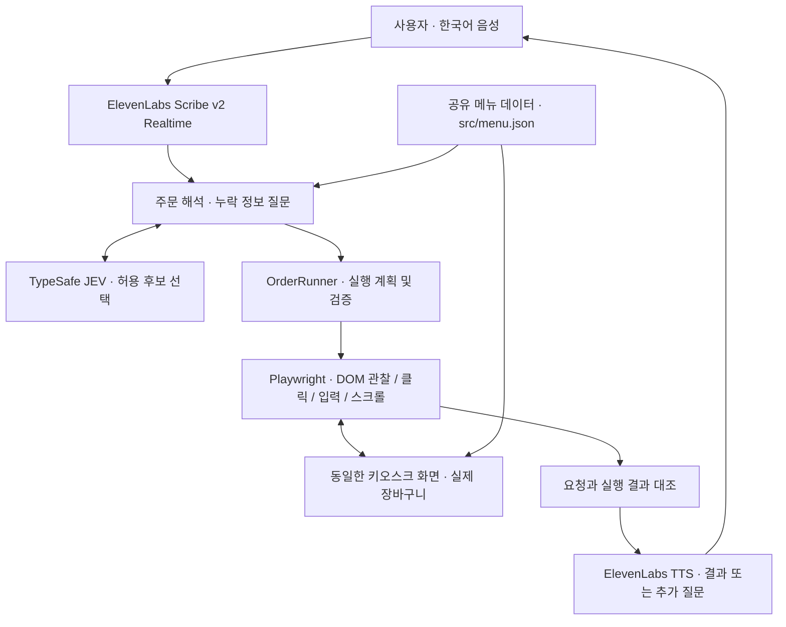

<div align="center">

# 🎙️ Easy Order

### 말로 주문하고, 화면에서 확인하세요.

복잡한 메뉴 탐색과 반복되는 터치를 줄이는 **한국어 음성 키오스크 프로젝트**


[프로젝트 소개](#overview) · [주문 경험](#experience) · [동작 구조](#architecture) · [빠른 시작](#quickstart) · [검증과 계획](#validation)

</div>

---

> **“아이스 아메리카노 두 잔 포장이요.”**<br>
> 원하는 주문을 말하면 필요한 정보를 확인하고, 같은 키오스크 화면에서 메뉴와 옵션을 선택합니다. 사용자는 실제 장바구니를 보며 주문을 확인하고 수정할 수 있습니다.

> [!IMPORTANT]
> 현재 저장소는 **제어 가능한 웹 키오스크의 시연 구현**입니다. 결제와 번호 적립은 모의 기능이며, 실제 결제·포인트·프린터·상용 키오스크 연동은 포함하지 않습니다.

<a id="overview"></a>

## 01 · 누구나 주문을 완성할 수 있도록

키오스크 주문은 메뉴를 고르는 일뿐 아니라 카테고리를 찾고, 옵션을 선택하고, 수량을 바꾸고, 실수를 되돌리는 여러 단계로 이루어집니다. 키오스크에 익숙하지 않은 고령층이나 디지털 기기 사용이 서툰 고객, 화면 탐색과 정밀한 터치가 어려운 고객에게는 이 과정 자체가 부담이 될 수 있습니다.

**Easy Order는 사용자의 말을 실제 화면 조작으로 연결하는 음성 주문 도우미입니다.** 사용자가 버튼의 위치나 메뉴의 화면 배치를 기억하지 않아도, 원하는 메뉴·온도·수량·매장 또는 포장 여부를 전달해 주문을 구성하는 것이 목표입니다.

| 사용자의 어려움 | Easy Order가 지향하는 경험 |
| :--- | :--- |
| 메뉴가 많고 화면 탐색이 복잡함 | 메뉴 이름을 말하면 해당 카테고리와 상품을 찾아 선택 |
| 옵션이나 수량을 빠뜨림 | 필요한 정보를 한 번에 하나씩 질문 |
| 잘못 담은 주문을 수정하기 어려움 | 수량·온도·샷 변경과 항목 삭제를 음성으로 요청 |
| 요청이 반영되었는지 알기 어려움 | 실제 장바구니와 처리 결과를 화면·음성으로 확인 |

제품 방향은 Notion의 **Easy Order 기획·요구사항 명세**를 바탕으로 합니다. 아래의 현재 기능은 저장소 구현을 기준으로 설명하며, Notion에 제안된 기능과 성능 목표를 구현 완료로 간주하지 않습니다.

<a id="experience"></a>

## 02 · 하나의 화면, 두 가지 주문 방법

터치 주문과 음성 주문은 **같은 React 키오스크와 장바구니**를 사용합니다. 별도의 제어 창이나 채팅 입력창 없이, 서버가 실행한 전체화면 Chromium의 오른쪽 아래 **음성 주문** 버튼에서 대화를 시작합니다.

### 대화로 이어지는 주문

| 단계 | 사용자의 말 또는 행동 | 처리 내용 |
| :---: | :--- | :--- |
| ① 시작 | **음성 주문** 버튼 선택 | 시작 화면에서는 “드시고 가시나요? 아니면 포장하시나요?” 안내 |
| ② 주문 | “아이스 아메리카노 두 잔 포장해 줘” | 메뉴·온도·수량·이용 방식을 해석하고 실제 버튼 조작 |
| ③ 수정 | “아메리카노 한 잔으로 바꿔줘” | 대상 장바구니 항목을 수정하고 결과 확인 |
| ④ 결제 요청 | “카카오페이로 결제해 줘” | 번호 적립 여부를 먼저 질문 |
| ⑤ 적립 선택 | “건너뛰기” | 모의 적립을 생략하고 금액·결제수단 안내 |
| ⑥ 확인 | “네, 진행해 주세요” | 현재 주문이 바뀌지 않았는지 검사 후 **모의 결제** 진행 |

### 빠진 정보는 질문으로 채웁니다

> **사용자** “녹차라떼”<br>
> **Easy Order** 온도 질문<br>
> **사용자** “아이스”<br>
> **Easy Order** 잔 수 질문<br>
> **사용자** “두 잔”

새 주문에서 잔 수를 생략하면 임의로 한 잔을 담지 않습니다. 한 번에 최대 **세 주문 항목**, 항목당 **1~20잔**을 요청할 수 있습니다. 같은 메뉴의 HOT·ICE가 함께 담겨 있다면 수정할 온도를 지정해야 합니다.

### 현재 구현된 기능

| 영역 | 지원 내용 |
| :--- | :--- |
| 메뉴 탐색 | 카테고리 선택, 세로 스크롤, 상품·옵션 버튼 클릭 |
| 주문 구성 | 매장·포장, HOT·ICE, 수량, 커피 메뉴의 샷 추가 |
| 주문 변경 | 장바구니 항목 수정·삭제, 모호한 대상에 대한 재질문 |
| 음성 입출력 | 한국어 실시간 인식, 인식 문장 표시, 질문·결과 음성 안내 |
| 모의 결제 | 카드·페이코·삼성페이·카카오페이·네이버페이·제로페이 선택 및 명시적 확인 |
| 모의 번호 적립 | 적립 여부 질문, 휴대폰 번호 11자리 입력·확인 또는 건너뛰기 |
| 종료 | 종료 버튼, 주문 완료, 무음·연결 오류에 따른 마이크 해제 |

> [!NOTE]
> 현재 메뉴 화면은 다음·이전 페이지 대신 세로 스크롤을 사용합니다. 실행·음성 안내 중에는 마이크가 닫혀 있으므로, 처리 중 중단에는 화면의 종료 버튼을 사용합니다. 항상 듣는 음성 인터럽트는 후속 검증 대상입니다.

<a id="architecture"></a>

## 03 · 주문 의도를 실제 클릭으로

**JEV는 주문과 행동을 판단하고, Playwright는 화면을 읽고 조작합니다.** 주문 결과는 React 상태를 직접 수정하는 대신, 사용자가 누르는 것과 같은 UI를 거쳐 장바구니에서 확인합니다.



### 화면 밖의 메뉴도 찾는 방법

키오스크 UI와 서버의 주문 해석기는 같은 [`src/menu.json`](src/menu.json)을 읽습니다. 메뉴의 ID·이름·카테고리·가격·가능한 온도를 공통 기준으로 사용하므로, 현재 화면에 보이는 버튼만으로 주문 대상을 추측하지 않습니다.

1. 전체 메뉴 후보에서 요청한 상품과 옵션을 식별합니다.
2. 해당 상품의 카테고리를 선택합니다.
3. 상품을 화면 안으로 스크롤한 뒤 메뉴·옵션·수량을 선택합니다.
4. 실제 장바구니의 메뉴·온도·샷·수량을 기대 결과와 비교합니다.

이 흐름은 현재 테스트 키오스크의 DOM 구조에 맞춰 구현되어 있습니다. 다른 업체의 키오스크에 적용하려면 메뉴 데이터와 화면 탐색·검증 방식을 연결하는 별도 작업이 필요합니다.

### 판단과 실행 사이의 확인 단계

- **허용된 선택지만 실행:** JEV 응답 형식·선택지·관련 확신도를 검사합니다.
- **실행 직전 화면 확인:** 관찰 시점과 현재 화면의 fingerprint가 다르면 진행을 중단합니다.
- **클릭 대상 대조:** JEV가 선택한 행동과 실행하려는 대상이 일치하는지 확인합니다.
- **장바구니 결과 검증:** 요청한 구성과 실제 장바구니가 일치해야 다음 단계로 진행합니다.
- **최종 확인 유효성 검사:** 모의 결제 동의 후에도 주문·화면이 바뀌었다면 기존 동의로 확정하지 않습니다.
- **제어할 페이지 제한:** 음성 요청 binding은 서버가 띄운 동일 키오스크 페이지의 메인 프레임에서만 받습니다.

### 기술 구성

| 계층 | 기술 | 담당 역할 |
| :--- | :--- | :--- |
| 화면 | React 19 · Vite 7 · Lucide | 메뉴, 옵션, 장바구니, 음성 상태 UI |
| 서버 | Node.js · Express 5 | 음성 요청, 세션, 외부 API 호출 관리 |
| 판단 | TypeSafe JEV | 주문 의도·항목 해석, 현재 가능한 행동 선택 |
| 음성 인식 | ElevenLabs Scribe v2 Realtime | 마이크 스트리밍과 한국어 STT |
| 음성 안내 | ElevenLabs Eleven Flash v2.5 | 질문·결과 TTS 및 로컬 캐시 |
| 화면 실행 | Playwright · Chromium | 전체화면 실행, DOM 관찰과 UI 조작 |
| 검증 | Node.js Test Runner · Chromium E2E | 주문 해석·대화·음성·실행 흐름 확인 |

<a id="quickstart"></a>

## 04 · 빠른 시작

**준비물:** Node.js **22.12 이상**, pnpm, 마이크·스피커, TypeSafe API 키, ElevenLabs API 키와 한국어 안내에 사용할 Voice ID.

### 1. 의존성과 브라우저 설치

```sh
git clone https://github.com/Ka11yV/easy-order.git
cd easy-order
pnpm install
pnpm exec playwright install chromium
```

### 2. 환경변수 설정

`.env.example`을 `.env`로 복사하고 값을 입력합니다. 이미 `.env`가 있다면 덮어쓰지 않고 필요한 항목만 추가하세요.

```sh
cp .env.example .env
```

```dotenv
# 서버 전용 인증 정보
TYPESAFE_API_KEY=your_typesafe_key
ELEVENLABS_API_KEY=your_elevenlabs_key
ELEVENLABS_VOICE_ID=your_voice_id

# 모델과 실행 설정
JEV_MODEL=jev-latest
ELEVENLABS_TTS_MODEL=eleven_flash_v2_5
JEV_MIN_CONFIDENCE=0.5
PORT=8787
BROWSER_HEADLESS=false
```

키에 `VITE_` 접두사를 붙이지 마세요. `.env`는 Git에서 제외되며 API 키는 서버에서 사용합니다. ElevenLabs 키에는 Speech to Text·Text to Speech 권한이 필요합니다. 환경변수를 바꾸면 서버를 재시작하세요. 외부 API 사용에는 서비스별 사용량이 발생합니다.

### 3. 음성 키오스크 실행

```sh
pnpm dev:agent
```

전체화면 키오스크가 자동으로 열리면 **음성 주문**을 누르고 마이크 권한을 허용합니다. macOS에서는 Chromium의 시스템 마이크 권한도 확인하세요.

> [!TIP]
> 음성 자동화는 **서버가 실행한 키오스크 창**에 연결됩니다. 다른 브라우저에서 주소를 열면 터치 주문은 가능하지만 그 탭에는 음성 자동화가 연결되지 않습니다. 키오스크 창을 다시 열려면 서버를 재시작하세요.

<details>
<summary><strong>실행 명령과 음성 세션 동작 자세히 보기</strong></summary>

| 명령 | 용도 |
| :--- | :--- |
| `pnpm dev:agent` | Vite 개발 환경과 전체화면 음성 키오스크 실행 |
| `pnpm dev` | 터치 UI만 개발하는 Vite 서버 |
| `pnpm build` | 프런트엔드 빌드 |
| `pnpm start` | 빌드된 화면으로 키오스크 실행; 먼저 `pnpm build` 수행 |

- 기본 서버 주소는 `http://127.0.0.1:8787`입니다. `/control`은 `/`로 이동합니다.
- 발화가 끝나고 약 1.5초간 조용하면 인식 문장을 전달합니다.
- 주문 처리와 TTS 안내 중에는 마이크를 닫고, 안내가 끝나면 다시 듣습니다.
- 45초간 발화가 없거나 연결 오류가 발생하면 마이크를 끄고 재시도를 안내합니다. 이미 담긴 주문은 유지됩니다.
- 안내는 “한 잔·두 잔·세 잔”처럼 자연스러운 한국어 잔 수 표현을 사용합니다.
- TTS 오디오는 `.cache/tts/`에 저장합니다. 동일 문구·음성·모델·설정이면 재사용하고, 256개·128MiB 한도를 넘으면 오래된 캐시부터 제거합니다.
- 입력한 전화번호는 TTS 안내에 포함하지 않습니다. 캐시와 환경변수 파일은 Git에서 제외됩니다.

</details>

## 05 · 코드 둘러보기

```text
src/
├── main.jsx          # 터치 키오스크 · 메뉴/옵션/장바구니/모의 결제
├── menu.json         # UI와 주문 해석기가 공유하는 메뉴 데이터
├── VoiceOrder.jsx    # 마이크 버튼 · 자막 · 음성 세션 상태
├── speech.js         # 공식 SDK를 통한 STT 스트리밍 · TTS 재생
└── pcm-worklet.js    # 오디오 처리
server/
├── index.js          # 개발/프로덕션 서버와 키오스크 시작
├── app.js            # 동일 페이지 binding · 요청과 세션 관리
├── jev.js            # JEV API 호출 · 응답 검증
├── planner.js        # 주문 해석 · 메뉴/옵션 검증 · 기대 장바구니
├── runner.js         # 주문 단계 실행 · 수정 · 모의 적립/결제 확인
├── browser.js        # DOM 관찰 · 클릭/입력 · 화면 변경 검사
├── speech.js         # 일회용 STT 토큰 · TTS 발급
├── korean.js         # 한국어 수량 표현
└── tts-cache.js      # TTS 디스크 캐시
tests/               # 단위 테스트 · 대화 테스트 · 브라우저 E2E
scripts/             # 실제 JEV 연동 확인 스크립트
```

STT 공급자를 교체하려면 `src/speech.js`의 `listen` 인터페이스와 서버의 토큰 발급 부분을 함께 조정합니다. 다른 키오스크 지원은 `browser.js`의 화면 관찰·실행과 `runner.js`의 탐색 규칙을 해당 환경에 맞추는 작업부터 시작합니다.

<a id="validation"></a>

## 06 · 검증 방법과 현재 범위

```sh
pnpm build
pnpm test
pnpm test:e2e
```

| 검증 | 실제로 확인하는 범위 | 확인하지 않는 범위 |
| :--- | :--- | :--- |
| 단위·대화 테스트 | 주문 해석, 옵션·수량, 응답 검증, 대화·음성 처리 로직 | 실제 매장 음향 환경 |
| 자동 E2E | 실제 Chromium, 테스트 마이크, STT SDK WebSocket 경로, 오디오 재생, UI 클릭 | 실제 외부 AI 인식·판단 품질; 응답은 테스트용으로 대체 |
| 실제 JEV 연동 스크립트 | 인식 완료 문장을 주입한 뒤 실제 JEV 판단과 Playwright 실행 | 실제 STT 인식률·TTS 음질 |

E2E에는 단일 키오스크 창 유지, 모의 결제 동의·거부, 중단, 마이크 권한 거부, 인증 설정 누락, 오래된 결제 확인 무효화 검사가 포함됩니다. 테스트 응답은 운영 코드에 포함되지 않습니다.

<details>
<summary><strong>실제 JEV를 사용하는 연동 검증 — API 사용량 발생</strong></summary>

```sh
pnpm test:live
pnpm test:live --extended
pnpm test:live --options
pnpm test:live --points
```

이 명령은 내부 binding에 문장을 주입하는 개발용 검사입니다. 사용자용 텍스트 입력 기능이 아닙니다. 테스트 캡처는 Git에서 제외된 `artifacts/`에 저장됩니다. 실제 음성 품질은 API 키·Voice ID 설정 후 마이크와 스피커를 사용해 매장 소음 조건에서 별도로 확인해야 합니다.

</details>

### 기획 목표와 후속 과제

Notion의 초기 목표는 **주문 성공률 90% 이상**, **첫 의미 있는 안내까지 p95 3초 이내**입니다. 이는 측정·검증할 목표이며, 현재 달성 수치를 의미하지 않습니다. 제안된 평가는 20개 시나리오를 각 3회 이상 반복하고, 취소·중단 결과와 정상 주문 성공률을 구분하는 방식입니다.

| 구분 | 범위 |
| :--- | :--- |
| 현재 구현 | 웹 카페 키오스크, 한국어 음성 주문·수정, 화면 조작 검증, 모의 결제·번호 적립 |
| 추가 구현·검증 | 처리 중 음성 중단, 다음 고객을 위한 세션·장바구니 초기화 정책, 품절 대응, 접근성·소음 환경 평가 |
| 확장 방향 | 식당 메뉴, 다양한 키오스크 화면, 다국어, 말하기 속도 조절 |
| 별도 연동 필요 | 실제 결제·회원/포인트 시스템, 카드 단말기, 영수증 프린터, 네이티브 키오스크 |

기획상 실제 서비스의 결제 경계는 **주문 확인 후 결제 화면을 사용자에게 인계**하는 것입니다. 저장소의 모의 결제 완료 화면은 시연용이며 실제 자동 결제를 구현한 것이 아닙니다. 웹 시연 성공만으로 모든 상용 키오스크 지원이나 접근성 검증 완료를 주장하지 않습니다.

## 07 · 참고 자료

- [Easy Order · Notion 기획·요구사항 명세](https://app.notion.com/p/3eb552973cb180a99c3fcdcd5f49a72d) — 프로젝트 배경·사용자 경험·평가 계획. 열람 권한이 필요할 수 있습니다.
- [TypeSafe JEV](https://docs.typesafe.ai/introduction/quickstart) — 구조화된 판단과 선택지 기반 호출
- [ElevenLabs Scribe SDK](https://elevenlabs.io/docs/eleven-api/resources/libraries/scribe-stt/javascript-scribe) · [TTS API](https://elevenlabs.io/docs/api-reference/text-to-speech/convert)
- [Playwright Locators](https://playwright.dev/docs/locators) — UI 요소 탐색과 실행
- [결제 이미지 출처](public/images/payments/SOURCES.md)

---

<div align="center">

**Easy Order · 버튼의 위치보다, 사용자의 말에 집중합니다.**

</div>
